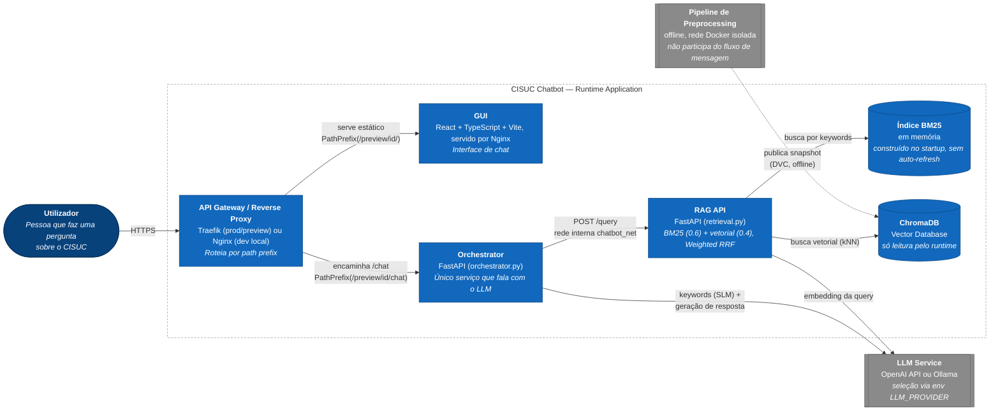

# Arquitetura de Contêineres — CISUC Chatbot (C4 Model)

Diagrama de **Contêineres** (nível 2 do C4 Model) da aplicação em runtime (`application/`), derivado de:

- `application/docker-compose.yaml` — stack base (rede `chatbot_net`)
- `application/docker-compose.nginx.yaml` — proxy Nginx que simula localmente o roteamento de produção
- `application/docker-compose.preview.yaml` + `deployment/docker-compose.proxy.yaml` — roteamento Traefik por path (`/preview/<id>/...`) para ambientes de preview de PR
- `preprocessing/docker-compose.yaml` — pipeline offline, em rede Docker própria (`preprocessing`), **sem ligação de rede com o runtime**; apenas publica artefactos (ChromaDB versionado com DVC) consumidos como imagem (`CHROMADB_FINAL_IMAGE`)

O fluxo mostrado é o de uma mensagem do utilizador: **UI → API Gateway → Orchestrator → RAG (BM25 + Vetorial) & LLM Service**.

## Documentos de detalhe (fluxo de código por componente)

Este documento cobre a topologia de contêineres. Para a lógica interna de cada componente — funções, decisões, chamadas externas — ver:

- [`fluxo_preprocessing.md`](./fluxo_preprocessing.md) — pipeline offline completo: scraping (estático/API/notícias) → enriquecimento LLM → chunking + embeddings → imagem ChromaDB final.
- [`fluxo_orquestrador.md`](./fluxo_orquestrador.md) — warm-up dos modelos, extração de keywords (SLM), fan-out de buscas e fusão (`intercalar_resultados`), geração streaming vs. não-streamed.
- [`fluxo_rag_retrieval.md`](./fluxo_rag_retrieval.md) — indexação BM25 no arranque, busca híbrida BM25+vetorial, fusão por Weighted RRF e rerank do pool.
- [`fluxo_evaluator_geracao_qa.md`](./fluxo_evaluator_geracao_qa.md) — extração do corpus por entidade, geração em lotes do ground truth (508 perguntas) e validação fact-checking retomável.
- [`fluxo_evaluator_ragas.md`](./fluxo_evaluator_ragas.md) — recolha de respostas via `/chat/avaliacao` e avaliação LLM-as-judge com Ragas (context_precision_topk, context_recall, faithfulness, answer_relevancy).

> Nota: o fluxo de resposta (streaming, `text/plain`) percorre o mesmo caminho em sentido inverso (RAG → Orchestrator → Gateway → browser); omitido do diagrama para não duplicar as setas.

## Notas sobre rede e exposição de portas

| Contêiner       | Rede(s)                              | Porta exposta ao host?                          |
|-----------------|----------------------------------------|--------------------------------------------------|
| `gui`           | `chatbot_net` (+ `preview_proxy` em preview) | Sim, local (`GUI_HOST_PORT:80`) — removida em preview, onde só o gateway expõe porta |
| `orchestrator`  | `chatbot_net` (+ `preview_proxy` em preview) | Sim, local (`ORCHESTRATOR_HOST_PORT:8002`) — removida em preview |
| `rag_cisuc`     | `chatbot_net`                           | Não — só acessível de dentro da rede interna |
| `chromadb`      | `chatbot_net`                           | Não — só acessível de dentro da rede interna |
| `development_proxy` (Nginx) | `chatbot_net`              | Sim (`80:80`) — simula localmente o papel do gateway de produção |
| `traefik` (gateway de preview) | `preview_proxy` (rede externa, partilhada entre PRs) | Sim (`8080:80` tráfego, `8081:8080` dashboard) |
| `preprocessing` / `chromadb` (pipeline offline) | `preprocessing` (rede isolada) | Não — sem qualquer ligação à rede do runtime |

**Pontos-chave do fluxo de mensagem:**
1. O browser nunca fala diretamente com a RAG API ou com o ChromaDB — só com GUI e Orchestrator.
2. O "API Gateway" é logicamente o Traefik (produção/preview, roteamento por `PathPrefix`) ou, em desenvolvimento local, o Nginx de `docker-compose.nginx.yaml`; sem nenhum dos dois, o browser chama a porta exposta do Orchestrator diretamente (modo `up`/`up-build` simples).
3. `rag_cisuc` e `chromadb` nunca têm porta publicada — só são atingíveis a partir de dentro de `chatbot_net`, reforçando que o Orchestrator é o único ponto de entrada para RAG/LLM.
4. O pipeline de preprocessing corre numa rede Docker totalmente separada (`preprocessing`) e não troca tráfego em tempo real com o runtime — a ligação é um artefacto versionado (imagem ChromaDB via DVC), não uma chamada de rede.
