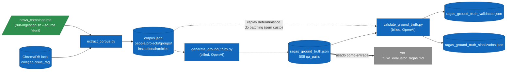
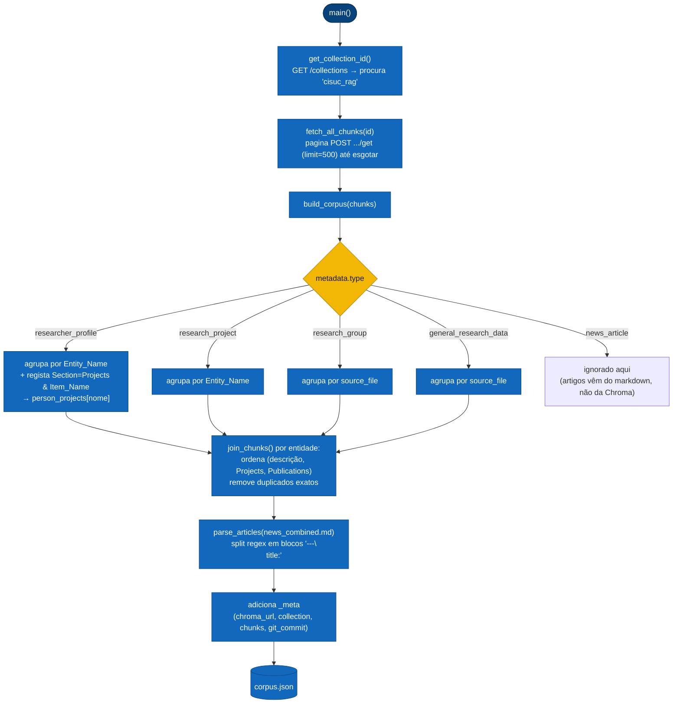
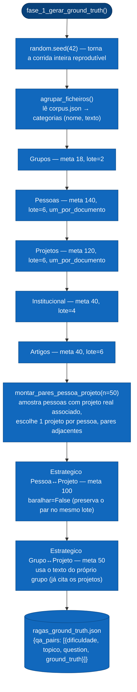
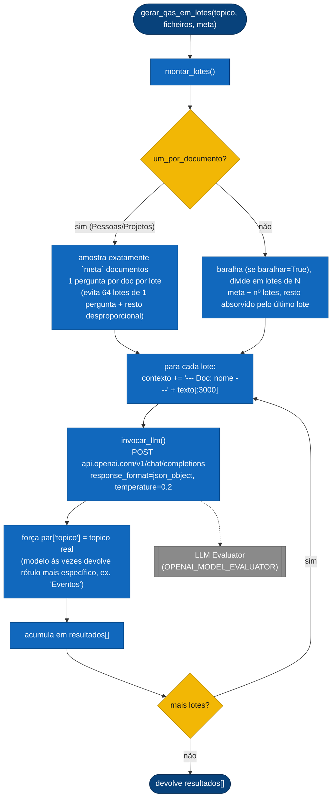
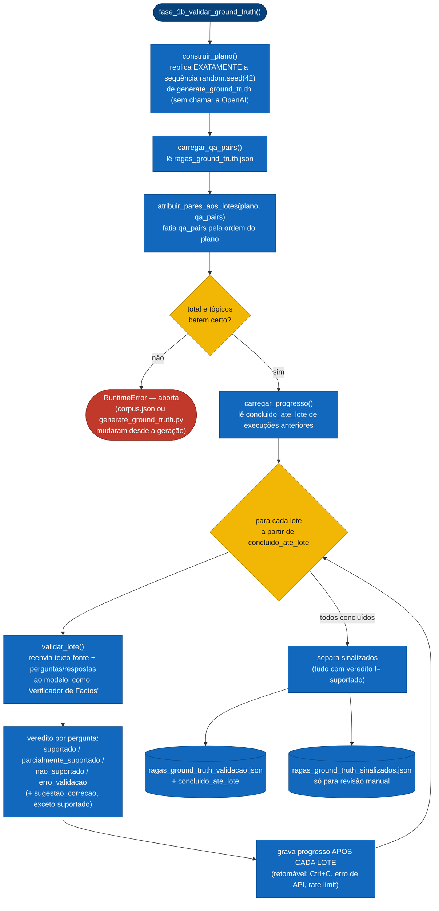

# Fluxo de Código — Evaluator: Geração do Ground Truth (QA)

Detalha `tests/qa_generation/{extract_corpus,generate_ground_truth,validate_ground_truth}.py`: a primeira metade do Evaluator, que produz o dataset de referência consumido pela avaliação RAGAS (ver [`fluxo_evaluator_ragas.md`](./fluxo_evaluator_ragas.md)). Corre offline, contra uma ChromaDB local, e faz chamadas reais e faturadas à OpenAI (exceto `extract_corpus.py`, que é grátis).

## 0. Visão geral do pipeline

## 1. `extract_corpus.py` — corpus por entidade

Os ficheiros que o `enhancement.py` escreve são **consolidados** (um único `enriched_api-users.md` com todos os investigadores); o gerador trunca cada documento a 3000 caracteres, então sem re-divisão todas as perguntas de "Pessoas" sairiam de uma ou duas entidades. Este script reconstrói um documento por entidade a partir dos chunks da própria ChromaDB — a mesma base que o RAG consulta em runtime, garantindo que as perguntas geradas têm resposta no que o sistema consegue efetivamente recuperar.

**Por que artigos não vêm da Chroma:** os chunks de notícias partilham todos o mesmo `source_file`/`Document_Title` do ficheiro consolidado, e o splitting por número de caracteres não respeita fronteiras entre artigos. O markdown de ingestão (pré-chunking) mantém um bloco `title:`/`date:`/`url:` exato por artigo.

## 2. `generate_ground_truth.py` — amostragem, batching e geração (508 perguntas)

Cada `Cat*` acima invoca a mesma subrotina `gerar_qas_em_lotes()`:

## 3. `validate_ground_truth.py` — fact-checking retomável

Não chama o RAG API, o Orchestrator nem a Chroma em runtime — valida cada `ground_truth` **contra o próprio texto-fonte que o gerou**, antes de esse ground truth ser usado como referência na avaliação RAGAS.

> Correções nunca são aplicadas automaticamente — a saída é uma lista de revisão, não um dataset corrigido. O script só abre `ragas_ground_truth.json` em modo leitura.

---
**Ver também:** [`arquitetura_geral.md`](./arquitetura_geral.md) · [`fluxo_evaluator_ragas.md`](./fluxo_evaluator_ragas.md)
