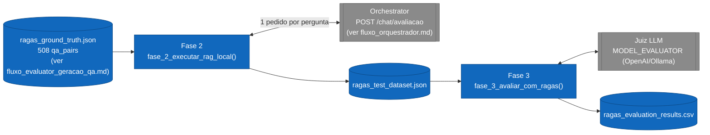
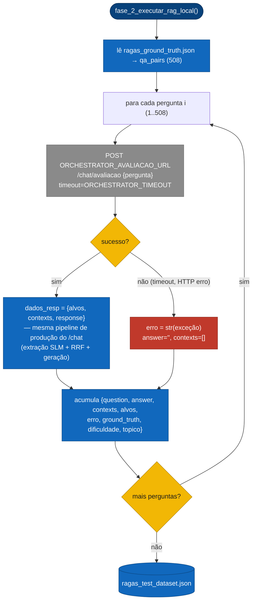
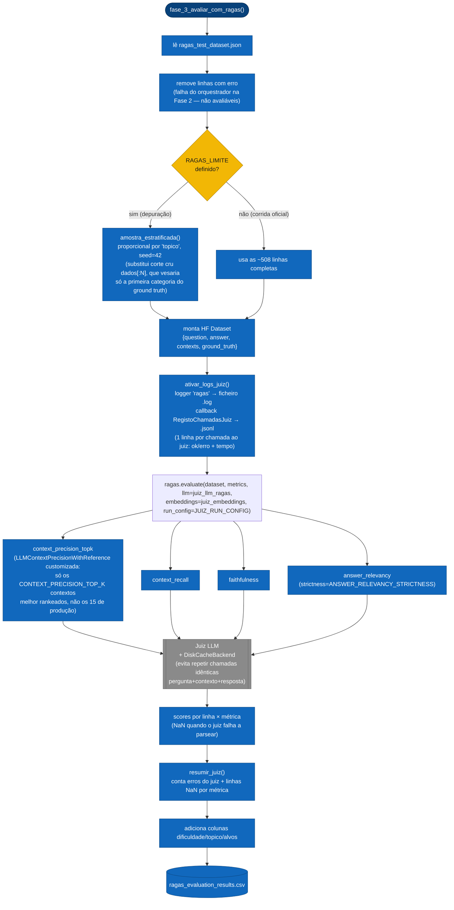

# Fluxo de Código — Evaluator: Avaliação RAGAS (LLM-as-Judge)

Detalha `tests/rag_ravluator.py`, Fases 2 e 3: a segunda metade do Evaluator, que corre o ground truth produzido em [`fluxo_evaluator_geracao_qa.md`](./fluxo_evaluator_geracao_qa.md) contra a pipeline de produção real do [Orchestrator](./fluxo_orquestrador.md) e pontua os resultados com a framework Ragas.

## 0. Visão geral (Fase 2 → Fase 3)

As duas fases rodam separadamente (`--fase 2` ou `--fase 3`) porque a Fase 2 é um gargalo de I/O (chamadas HTTP sequenciais ao Orchestrator) e a Fase 3 é um gargalo de chamadas ao juiz — permite reexecutar a avaliação (Fase 3) sobre o mesmo `ragas_test_dataset.json` sem repetir a coleta.

## 1. Fase 2 — recolha de respostas e contextos (produção real)

> **Por que via `/chat/avaliacao` e não chamando a RAG API diretamente:** resposta e contextos vêm da **mesma chamada** ao pipeline de produção — se a avaliação usasse uma reimplementação paralela da recuperação, um bug exclusivo dessa reimplementação poderia inflar ou deflacionar scores sem refletir o sistema real.

## 2. Fase 3 — avaliação RAGAS (LLM como juiz)

### Por que `context_precision_topk` tem nome próprio

A métrica `context_precision` original do Ragas avalia **todos** os contextos recuperados — aqui seriam os 15 de produção (`RAG_TOP_K`), o que custa uma chamada ao juiz por contexto por pergunta. `ContextPrecisionTopK` é uma subclasse que corta `retrieved_contexts` para os `CONTEXT_PRECISION_TOP_K` melhor rankeados antes de avaliar — o maior item de custo da avaliação — sem alterar os contextos vistos por `faithfulness`/`context_recall`, nem o `RAG_TOP_K=15` de produção. Como o valor computado (precisão@top_k) não é comparável à métrica original, tem nome próprio em vez de reusar `context_precision`.

### Resiliência do juiz

`RunConfig(max_retries=RAGAS_MAX_RETRIES)` substitui o padrão do Ragas (10 retries) — falhas de parsing de um juiz local (Ollama) tendem a ser deterministicas, então repetir até 10× só desperdiça chamadas sem nunca salvar a linha. O `DiskCacheBackend` é o único item do pipeline sem nenhuma contrapartida de qualidade: só evita refazer trabalho (chamadas idênticas) já pago em corridas anteriores.

---
**Ver também:** [`arquitetura_geral.md`](./arquitetura_geral.md) · [`fluxo_orquestrador.md`](./fluxo_orquestrador.md) · [`fluxo_evaluator_geracao_qa.md`](./fluxo_evaluator_geracao_qa.md)
