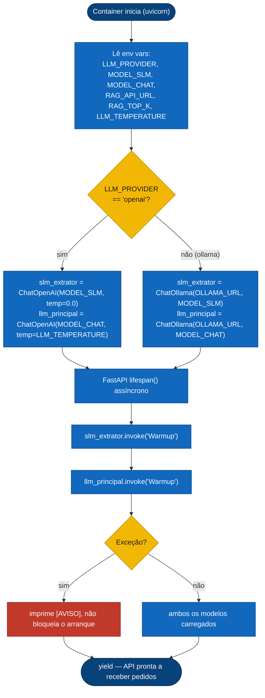
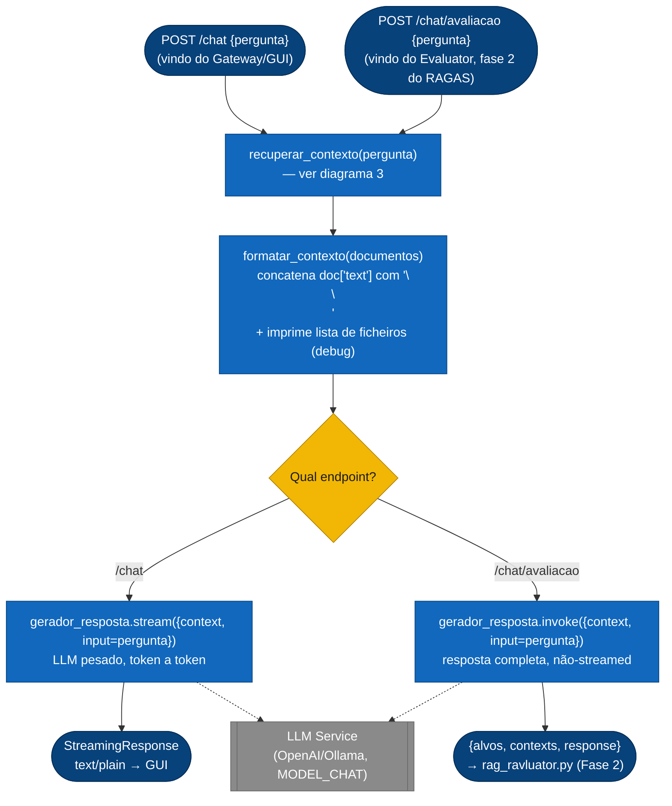
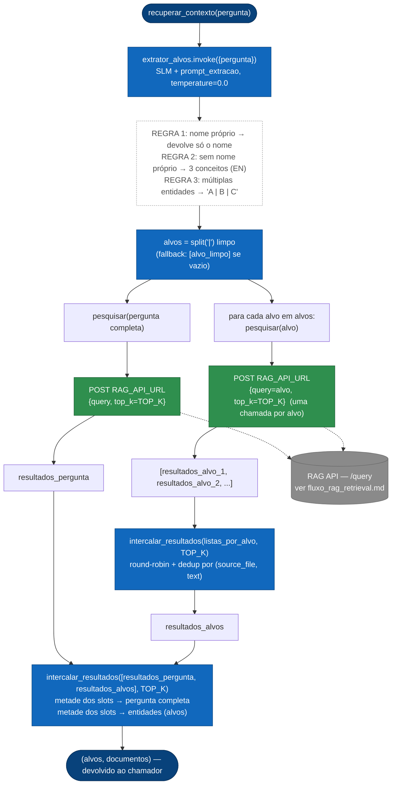
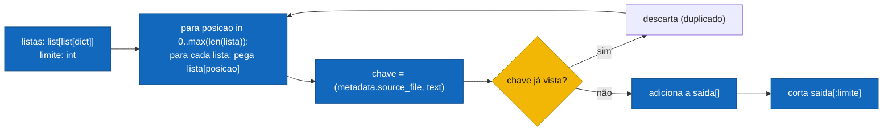
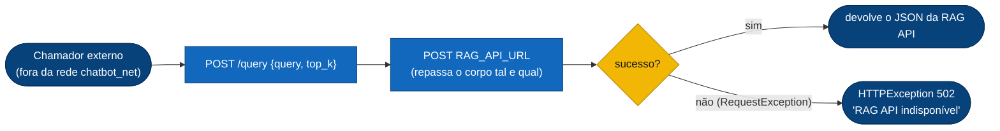

# Fluxo de Código — Orchestrator

Detalha a lógica interna de `application/Orchestrator/orchestrator.py`: o único serviço que fala com o LLM (ver [`arquitetura_geral.md`](./arquitetura_geral.md)). Dois dos seus endpoints (`/chat` e `/chat/avaliacao`) partilham exatamente o mesmo caminho de recuperação — `/chat/avaliacao` é o que o [Evaluator](./fluxo_evaluator_ragas.md) usa para obter resposta + contextos de uma única execução de produção, em vez de simular a pipeline à parte.

## 1. Arranque — pré-aquecimento dos modelos (`lifespan`)

> O warm-up só aquece os modelos para a primeira chamada ser rápida — uma falha aqui é só um aviso em log, nunca impede o arranque do serviço.

## 2. Pedido de chat — `/chat` vs `/chat/avaliacao`

Ambos os endpoints chamam a mesma `recuperar_contexto()` e `formatar_contexto()`; divergem só no passo final de geração (streaming vs. invocação única) e no formato de resposta.

Prompt do gerador final (`system_prompt`, resumido): responder **apenas** com base no `{context}` injetado, nunca alucinar, admitir quando a resposta não está no contexto, responder em PT ou EN conforme a pergunta.

## 3. `recuperar_contexto()` — extração de alvos + fan-out + fusão

O núcleo da orquestração: transforma uma pergunta em texto livre em uma ou mais queries de busca, dispara-as contra a RAG API, e funde os resultados preservando representação de todas as entidades perguntadas.

**Por que a pergunta completa *e* os alvos?** Os keywords sozinhos perdem a parte descritiva da pergunta (ex: "o investigador com foco em X") — por isso a pergunta completa também é pesquisada, e os dois conjuntos de resultados são intercalados, não concatenados, para que nenhuma das duas fontes domine o `TOP_K` final.

**`intercalar_resultados()`** (dedup + round-robin, usada duas vezes acima):

## 4. `/query` — proxy simples

A RAG API não tem porta exposta no host (ver `arquitetura_geral.md`), então chamadas externas (ex: scripts de debug) passam por aqui:

---
**Ver também:** [`arquitetura_geral.md`](./arquitetura_geral.md) · [`fluxo_rag_retrieval.md`](./fluxo_rag_retrieval.md) · [`fluxo_evaluator_ragas.md`](./fluxo_evaluator_ragas.md)
