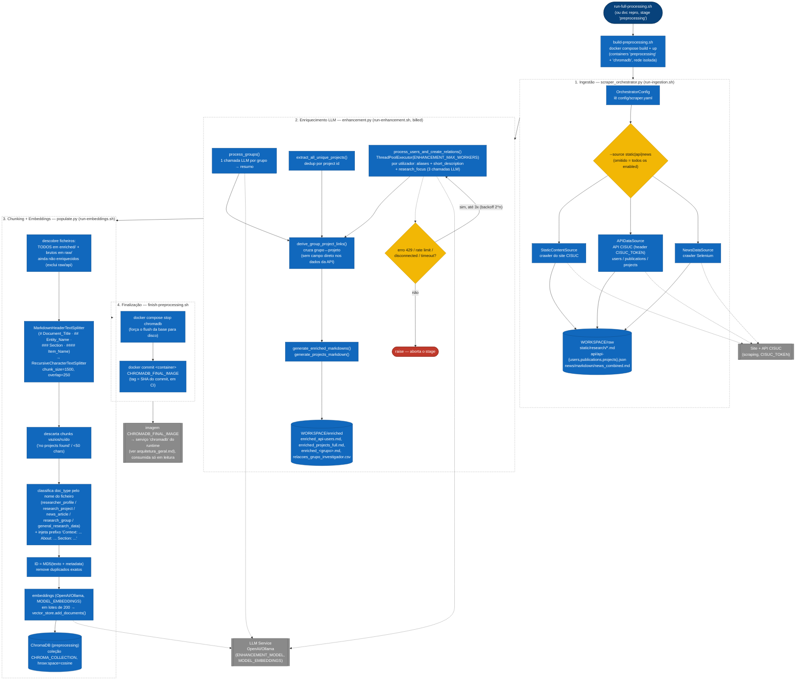

# Fluxo de Código — Pipeline de Preprocessing (offline)

Detalha o pipeline offline completo (`preprocessing/`), que roda numa rede Docker isolada (`preprocessing`, sem ligação ao runtime — ver [`arquitetura_geral.md`](./arquitetura_geral.md)) e produz os artefactos que o [RAG Hybrid Engine](./fluxo_rag_retrieval.md) e o [Evaluator](./fluxo_evaluator_geracao_qa.md) consomem: `.local/raw`, `.local/enriched` e a imagem ChromaDB populada.

Orquestrado ponta-a-ponta por `scripts/run-full-processing.sh` (ou, sem a construção da imagem Chroma, por `scripts/run-preprocessing-data.sh`, o comando do stage `preprocessing` em `dvc.yaml`).

## Notas

- **Fronteira do DVC**: o stage `preprocessing` de `dvc.yaml` só cobre as fases **1** e **2** (`run-preprocessing-data.sh` = ingestão + enriquecimento) — os `outs` versionados são `.local/raw` e `.local/enriched`. As fases **3** (embeddings) e **4** (commit da imagem) não são rastreadas pelo DVC: a imagem ChromaDB resultante é versionada por **tag de commit Git** em CI (ver "Image tagging" em `CLAUDE.md`), não por `dvc repro`.
- **Cada fase é independentemente re-executável** — só é preciso rodar de novo a fase cujo input mudou (ex.: mudar só o prompt de enriquecimento não exige repetir o scraping).
- **Descoberta de ficheiros na fase 3** prioriza o conteúdo enriquecido: um ficheiro bruto só é processado (sem contexto injetado pelo LLM) se a sua versão `enriched_<nome>.md` ainda não existir — o chunking nunca processa as duas versões do mesmo documento.
- **Falhas de enriquecimento são fail-fast**: um erro não-recuperável (não é 429/rate-limit/disconnect/timeout) propaga e aborta o stage inteiro, em vez de gravar um resumo parcial/alucinado.

---
**Ver também:** [`arquitetura_geral.md`](./arquitetura_geral.md) · [`fluxo_rag_retrieval.md`](./fluxo_rag_retrieval.md) · [`fluxo_evaluator_geracao_qa.md`](./fluxo_evaluator_geracao_qa.md)
