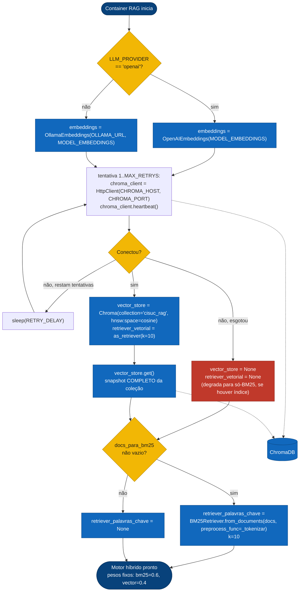
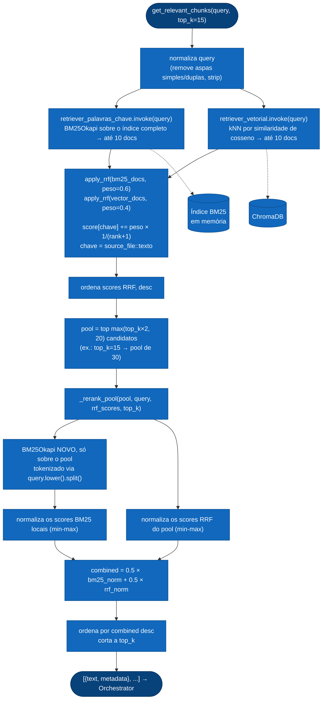

# Fluxo de Código — RAG Hybrid Engine (BM25 + Vetorial + RRF)

Detalha a lógica interna de `application/RAG_CISUC/retrieval.py`, chamado pelo [Orchestrator](./fluxo_orquestrador.md) via `POST /query` e nunca exposto fora da rede `chatbot_net` (ver [`arquitetura_geral.md`](./arquitetura_geral.md)).

## 1. Arranque — ligação ao ChromaDB + construção do índice BM25

> **Isto corre uma única vez, no arranque do container.** O índice BM25 (e o snapshot que o alimentou) não se atualiza sem reiniciar o serviço — uma reindexação da ChromaDB em produção só se reflete na busca lexical após restart do RAG API.

## 2. `get_relevant_chunks(query, top_k=15)` — busca híbrida, RRF ponderado e rerank

Este é o caminho percorrido a cada pedido do Orchestrator. Tem três estágios: (a) duas buscas independentes, (b) fusão por Weighted Reciprocal Rank Fusion sobre um pool alargado, (c) uma segunda passagem de rescoring lexical sobre esse pool antes do corte final.

### Por que RRF seguido de um rerank, e não só RRF

- **Fusão (RRF ponderado)**: combina dois espaços de score não comparáveis (BM25 é frequência-termo, cosseno é similaridade semântica) usando só a *posição* de cada doc em cada lista — robusto, mas grosseiro: o doc certo pode estar fundido mas enterrado no meio do pool.
- **Rescoring**: o pool é alargado para 2×`top_k` (mínimo 20) propositalmente *antes* do corte, para dar à segunda passagem material suficiente para recuperar o doc certo quando ele está "enterrado" no RRF. Essa segunda passagem roda um BM25 local só sobre o pool, mistura 50/50 com o score RRF normalizado, e só então corta para `top_k`.

> **Detalhe de implementação:** o índice BM25 principal usa `_tokenizar()` (regex `\w+`, minúsculas), enquanto o rerank local usa `query.lower().split()` — tokenizadores diferentes nas duas passagens. Documentado aqui porque está no código tal como é, não porque seja necessariamente o comportamento pretendido.

---
**Ver também:** [`arquitetura_geral.md`](./arquitetura_geral.md) · [`fluxo_orquestrador.md`](./fluxo_orquestrador.md)
